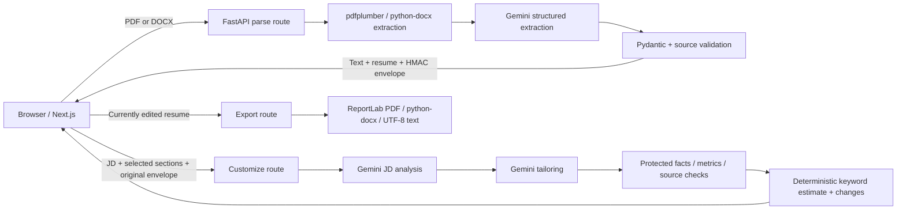

# TailorCV

A working resume customization app: add a job description, upload a PDF or DOCX, select sections, review evidence-linked edits, make your own changes, and download PDF, DOCX, or plain text.

## Submission status

Source is published at [Lakshay093/tailorcv](https://github.com/Lakshay093/tailorcv). The [public app](https://tailorcv-orcin.vercel.app) connects to the [Render API](https://tailorcv-api-amdh.onrender.com/health). Before the interface redesign, the deployed workflow passed a real Gemini browser test covering upload, tailoring, protected fields, editing, all three downloads, and desktop/mobile layouts. The latest full live check after the redesign was blocked by Gemini quota; the updated Customize button passed a public check without AI calls, and all eight mocked-provider browser tests passed. Full results and hosting limitations are recorded in [VERIFICATION.md](VERIFICATION.md). Mocked automated tests and live-provider checks are reported separately.

The Resume Studio interface starts with your uploaded resume and immediately previews its structured content. Add the target role, choose the sections to tailor, compare changes, edit the result, and export from the controls above the document. Desktop step navigation, mobile preview shortcuts, keyboard-accessible help, and a confirmed reset keep the current application easy to manage. The connection check allows 90 seconds for the demo backend to wake up, and successful requests clear a stale connection notice.

Customize Resume stays available for validation whenever the app is idle. Clicking it explains missing inputs or incomplete AI preparation in a focused alert. A provider quota failure preserves the uploaded file, job description, and extracted-text preview; blocked customization makes no provider request. The input counter tracks the two inputs independently of AI readiness. Once AI structuring succeeds, the same button starts customization normally. The browser regression simulates a quota response and verifies zero blocked customization requests, then successful customization after preparation recovers.

## Stack

- Frontend: Next.js 16.4.1 App Router, React 19.3.1, TypeScript 6.0.3, Tailwind CSS 4.3.3, shadcn-style source-owned Button/Tabs components using Radix and CVA, Lucide icons.
- Backend: Python 3.12, FastAPI 0.143.1, Pydantic 2.14.1.
- AI: Google's official `google-genai==2.31.0` Python SDK. The configured and live-tested model is **`gemini-3.6-flash`**. Resume structuring, JD analysis, tailoring, factual checks, and both document exports passed a real-provider smoke test. The initially chosen `gemini-3.8-flash` returned high-demand errors during verification.
- Parsing: pdfplumber 0.11.10 and python-docx 1.2.0. Exports: ReportLab 5.0.1 and python-docx.
- Tests: pytest and Playwright Chromium, desktop and mobile.

Direct dependencies are pinned. `frontend/package-lock.json` and `backend/uv.lock` lock transitive dependencies. Use Node 24 LTS and Python 3.12. Node 21 is outside the supported runtime range.

## AI tools used

| Tool | How it was used |
| --- | --- |
| OpenAI Codex | Coding assistant for implementation, interface design, debugging, automated test development, documentation, and deployment assistance. |
| Google Gemini through the official `google-genai` SDK | Runtime AI for structuring extracted resume text, analyzing the job description, and rewriting selected resume sections. The configured model is `gemini-3.6-flash`; it can be changed through backend configuration. |

PDF/DOCX text extraction, factual validation, keyword scoring, change comparisons, and file generation run in application code. Gemini output is validated and still requires the user's review. Automated tests use synthetic resumes and provider doubles; separate opt-in checks exercise the real Gemini service. No API keys, account tokens, or private resume content are required in the repository.

## Local setup

Install Git, [Node 24](https://nodejs.org/en/download), [Python 3.12](https://www.python.org/downloads/), and [uv 0.13.1](https://docs.astral.sh/uv/getting-started/installation/). If needed, install uv with `python -m pip install uv==0.13.1`. Docker is optional for local development.

Clone the repository, or use your existing checkout:

```powershell
git clone https://github.com/Lakshay093/tailorcv.git
cd tailorcv
```

The following commands use PowerShell. On macOS/Linux, replace `Copy-Item` with `cp`.

### 1. Start the backend

In a terminal opened at the repository root:

```powershell
cd backend
uv sync --frozen --python 3.12
Copy-Item .env.example .env
```

Edit `backend/.env` and set `GEMINI_API_KEY` to your own key from [Google AI Studio](https://aistudio.google.com/api-keys). Keep the example's other values for local development. The example signing key is for local use only; production requires the random key described below. Copy environment examples only on first setup so existing local values are preserved.

Then, from `backend/`, run:

```powershell
uv run uvicorn app.main:app --host 0.0.0.0 --port 8000 --no-access-log
```

### 2. Start the frontend

Open a second terminal at the repository root:

```powershell
cd frontend
npm ci
Copy-Item .env.example .env.local
npm run dev
```

The frontend example already sets `NEXT_PUBLIC_API_BASE_URL=http://localhost:8000`. Restart the frontend after changing it. Leave both terminals running. Open [localhost:3000](http://localhost:3000); check the API at [localhost:8000/health](http://localhost:8000/health) or its interactive docs at [localhost:8000/docs](http://localhost:8000/docs).

### 3. Try the workflow

Choose **Try sample data**, or upload the synthetic [PDF](samples/alex-morgan.pdf) / [DOCX](samples/alex-morgan.docx) and paste the [sample job description](samples/job-description.txt). A custom JD needs at least 100 non-whitespace characters. Wait for AI structuring, select sections, click **Customize Resume**, review and edit the result, then download PDF, DOCX, or TXT. No login or database setup is required.

Without a key, upload still extracts real text and displays a clear setup warning; AI structuring/customization cannot run. **Try sample data** loads a synthetic DOCX and JD through the same production parsing/AI pipeline. It does not substitute canned AI results. Provider doubles and simulated API failures are confined to test code.

## Environment

| Variable | Default / purpose |
| --- | --- |
| `GEMINI_API_KEY` | Required for AI calls, backend only. Never prefix with `NEXT_PUBLIC_`. |
| `GEMINI_MODEL` | `gemini-3.6-flash`; change only to a model supporting JSON schema output. |
| `ALLOWED_ORIGINS` | Explicit comma-separated frontend origins. Local: `http://localhost:3000,http://127.0.0.1:3000`. Production: exact HTTPS frontend domain(s), no wildcard. |
| `MAX_UPLOAD_MB` | 5; maximum raw upload size in MiB. |
| `JD_MIN_CHARS` | 100 non-whitespace characters. |
| `JD_MAX_CHARS` | 30,000 total characters. |
| `MAX_RESUME_CHARS` | 50,000 extracted characters; oversized text is rejected, never silently truncated. |
| `MAX_DOCUMENT_PAGES` | 30 PDF pages. |
| `PROVIDER_TIMEOUT_SECONDS` | 45 per provider attempt. |
| `PROVIDER_RETRIES` | 2 retries after the first attempt; exponential backoff. Maximum 2. |
| `RATE_LIMIT_PER_MINUTE` | 10 combined parse/customize requests per observed peer IP per process. |
| `RESUME_SIGNING_KEY` | Shared HMAC secret for stateless original-data integrity. Production requires a random 32+ character value, identical on all instances. Keep stable through restarts; rotating it requires users to upload again. |
| `ENVIRONMENT` | `development`; production validates HTTPS CORS origins and signing-key strength. |
| `NEXT_PUBLIC_API_BASE_URL` | Frontend only: `http://localhost:8000` locally; Render HTTPS API URL in production. It is public and compiled at frontend build time. |

Generate a production signing key with `python -c "import secrets; print(secrets.token_urlsafe(48))"`. Store it in the hosting secret manager, never source control.

### Credentials and private data

- Commit only the environment examples. Real `.env` files, `.env.local`, local deployment helpers, and `.vercel` metadata are ignored by Git.
- Store `GEMINI_API_KEY` and the production `RESUME_SIGNING_KEY` in the backend environment. `NEXT_PUBLIC_API_BASE_URL` is a public URL, not a place for credentials.
- Render/Vercel account tokens are deployment credentials, not application settings. They are not needed to run the app locally and must stay out of source, README examples, screenshots, and logs.
- Use the supplied synthetic samples for demos and tests. Read the privacy limits below before uploading personal documents.

## Architecture



No authentication, database, resume IDs, or history store. Parser bytes and documents are handled in memory; the multipart framework can spool large uploads to temporary storage, which is closed after extraction. No upload is saved as application history. The original text and structured snapshot remain in browser memory until navigation/reload. Source tokens are HMACs over both original text and original structure, not process-local IDs; any instance with the shared key can verify them.

### Project layout

```text
frontend/src/app/          App Router page, layout, and responsive styles
frontend/src/components/  Workspace, editable document view, shadcn UI primitives
frontend/src/lib/         Typed API helpers and shared frontend types
frontend/tests/           Desktop/mobile Playwright workflow
backend/app/routes.py     REST endpoints
backend/app/schemas.py    Request, resume, analysis, and result schemas
backend/app/parsing.py    File validation and extraction
backend/app/llm.py        Official asynchronous Gemini client, retries and repair
backend/app/prompts.py    Dedicated structuring, JD, and factual-editing prompts
backend/app/accuracy.py   Source integrity, stable IDs, protected facts, comparisons
backend/app/scoring.py    Backend keyword heuristic
backend/app/exports.py    PDF/DOCX/text templates
backend/app/config.py     Environment configuration
backend/tests/            Synthetic fixtures, provider doubles, meaningful tests
samples/                  Synthetic resume in PDF/DOCX/text/JSON, sample JD
render.yaml               Render service blueprint
```

## API

| Method / route | Request | Result |
| --- | --- | --- |
| `GET /health` | None | Service health, public input limits, and whether AI is configured; no secrets. |
| `POST /api/resume/parse` | Multipart `file` | Original extracted text, structured resume, stable IDs, source token, warnings, filename. |
| `POST /api/resume/customize` | JSON: `job_description`, `original_text`, `original_resume`, `source_token`, `sections` | Tailored resume, deterministic before/after changes, job analysis, keyword estimate, missing-term suggestions, warnings, configured model. |
| `POST /api/resume/export` | JSON: `resume`, `format` (`pdf`, `docx`, `txt`) | Actual downloadable file with an appropriate MIME type and `Content-Disposition`. |

`sections` is a nonempty unique subset of `summary`, `skills`, `experience`, `projects`. Contact, education, certifications, additional sections, chronology, role/project metadata, and original bullet membership are protected.

All error bodies follow:

```json
{"error":{"code":"JD_TOO_SHORT","message":"Add at least 100 non-whitespace characters to the job description.","request_id":"..."}}
```

Common statuses: 400 invalid document, 413 input too large, 415 unsupported/mismatched type, 422 schema/factual/content validation, 429 local throttling/provider quota, 502 invalid AI output, 503 missing credentials/unavailable model/provider, 504 provider timeout. Responses include `X-Request-ID` and no-store headers. Validation errors do not echo private input values.

**Independent extraction:** if document extraction succeeds but AI structuring fails, `/parse` deliberately returns 200 with `structured_resume: null`, `source_token: null`, and a warning carrying the stable failure code. The user can inspect real extracted text and retry structuring without losing the JD. A null structure cannot be submitted for customization. Invalid document extraction returns an HTTP error.

## Factual accuracy and prompt design

Resume structuring and tailoring use separate requests and separate schemas. Structuring must copy source wording exactly, represent unknown sections, and reference each bullet's supporting excerpt. The server assigns deterministic entry/bullet IDs and validates extracted protected values and source excerpts against the original text. Potentially uncovered source lines produce a review warning; raw extracted text is always retained for comparison.

The dedicated tailoring system prompt treats resume/JD content as untrusted data, ignores embedded instructions, prohibits fabricated qualifications and keyword stuffing, preserves protected fields and chronology, and requires unchanged unselected sections. JD terms must occur in the supplied JD. Pydantic validates every AI response.

The server rejects modified contact information, employers/titles/dates, education/certifications/additional sections, project metadata, lost or relocated bullets, changed bullet metrics, new summary numbers, new/deleted skills, and newly inserted known JD terms absent from the source. Unselected sections are restored from the original and flagged if the model changed them. Skills can be reordered only. Changes include stable IDs, before/after text, source excerpts, and clear rewritten/reordered labels.

These checks cannot prove semantic equivalence of every sentence or detect every invented nonnumeric claim. All generated output is explicitly marked for user review. Missing source terms appear as suggestions requiring confirmation, never as resume bullets. User edits are intentional and can change any displayed field; exports use the edited data. Generated comparisons and scores are not recomputed after manual edits, and the UI labels that limitation.

Provider calls use the official SDK's async API with `response_json_schema` derived from the Pydantic model, `response_mime_type="application/json"`, explicit timeouts, SDK retries disabled, and at most two application retries for quota/transient server/timeout failures. Generation schemas retain their structure and `additionalProperties` rules while omitting string/array bounds and defaults to avoid Gemini's schema-state limit. Pydantic enforces every original bound on the returned JSON. The JSON Schema wire field also avoids the SDK's incompatible OpenAPI conversion. Transport tests exercise the actual SDK serializer for all three response schemas. One schema repair regenerates from original inputs, then malformed output returns an error. Each schema operation can therefore make at most six provider calls in the worst case (two generations, three transport attempts each); customize has two operations. Semantic/factual validation failures are rejected, not automatically repaired or presented as verified.

## Keyword match estimate

The model extracts at most 40 distinct concrete terms from the JD. Backend code verifies that each term occurs there, deduplicates case-insensitively, and compares both resumes against exactly the same list. Each term has equal weight. Matching is case-insensitive with Unicode word boundaries and whitespace normalization; `C++`, `C#`, and short terms avoid naive substring matches.

`score = round(100 × matched distinct terms / all distinct JD terms)`

Both resumes show matched/missing terms. There is no target score or forced improvement. This is a **heuristic estimate, not an official ATS score**, a semantic assessment, or a shortlisting guarantee. Exact-term matching misses valid synonyms and context.

## Parsing, exports, and privacy limits

- PDF/DOCX only. Extension, declared MIME, magic bytes/container structure, and the actual parser all participate in validation. Generic binary MIME is allowed but content is still inspected. Empty, corrupt, renamed, encrypted, oversized, and textless documents produce specific messages.
- DOCX paragraphs and tables are read in body order, with safeguards against excessive ZIP expansion. Headers, footers, text boxes, images, and nested table layout can be incomplete. PDF column/reading order is best effort. Preview extraction before customizing.
- OCR is not implemented. Scanned PDFs need a text-based replacement. No silent input truncation.
- Downloads use a standardized single-column template, not the uploaded document's visual layout. PDF text is selectable, long words wrap, and flowing blocks paginate without clipping. Suggestions and analysis stay outside exports.
- Bundled SIL-OFL Noto Sans regular/bold covers Latin, Greek, Cyrillic, and many symbols. Unsupported PDF glyphs produce an explicit error rather than invisible text or boxes. DOCX/text remain available for other scripts, subject to the reader's font support. Exact universal Unicode/CJK/emoji rendering is not claimed.
- Resume and JD text go to Google Gemini. No app database, file history, analytics, or content logging is configured. Hosting ingress and Google may apply their own logging/data retention; review [Gemini terms](https://ai.google.dev/gemini-api/terms) and use an appropriate project/tier for sensitive data.
- React escapes document content; no raw model HTML is rendered. ReportLab XML text is escaped. Exports do not contain prompts, source evidence, suggestions, or scores.
- In-memory per-IP rate limiting is a basic single-process safeguard, not a distributed quota or cost cap. It resets at restart and multiplies across workers/instances. Configure trusted ingress proxy IPs correctly; the app never accepts arbitrary client forwarding headers. Add an ingress rate limit/WAF or shared limiter and provider budget controls for a broader public launch. No background jobs or cancellation guarantee for provider work after a browser disconnect.

## Verification

```bash
cd backend
uv run pytest -q

cd ../frontend
npm run lint
npm run typecheck
npm run build
npx playwright install chromium
npm run test:e2e
```

Run this block from the repository root after installing both projects' dependencies. These checks do not need a working Gemini key or consume provider quota. Playwright launches the real frontend and FastAPI server on ports 3000 and 8001. Gemini is replaced by a test dependency override in `tests.mock_server`; a browser regression also injects an incomplete-structuring response to test quota feedback. The production application has no mock-mode setting. The eight desktop/mobile browser checks cover immediate resume previews, JD entry, extraction, section selection, customization, changes/suggestions, editing, three downloads, keyboard focus, help, connection recovery, reset confirmation, errors, and preserved inputs. They check for browser exceptions and horizontal overflow and capture screenshots. Backend tests validate exported file content after edits. CI repeats backend, frontend, and browser checks on Linux.

The browser suite must own its test ports; stop a local frontend on port 3000 before running it. Linux CI uses `npx playwright install --with-deps chromium`. The Windows test config selects `.venv/Scripts/python.exe`; Linux uses `.venv/bin/python`. Override with `E2E_PYTHON` if necessary.

**Optional live AI checks:** these consume the configured project's Gemini quota and may incur charges on a paid tier. They are excluded from normal CI. From `backend/`, run `uv run python scripts/smoke_real_provider.py` with a working backend key. To test the deployed application, run the following from `frontend/` in PowerShell:

```powershell
$env:LIVE_APP_URL = 'https://tailorcv-orcin.vercel.app'
npm run test:live
```

For Bash use `LIVE_APP_URL=https://tailorcv-orcin.vercel.app npm run test:live`. The public workflow uploads only the synthetic sample, verifies protected fields and unselected projects, edits the result, downloads all three formats, and inspects both viewport sizes without duplicating generation for mobile. The deployed backend supplies its own Gemini key; no key belongs in `LIVE_APP_URL` or the browser.

See [VERIFICATION.md](VERIFICATION.md) for checks actually run and remaining limitations.

To check the published Customize button without spending AI quota, set `LIVE_APP_URL` and run `npm run test:live -- button-validation.spec.ts`. This validates visible, focused feedback on desktop and mobile, and asserts that no parsing or customization API requests were made.

## Deployment: Render backend, Vercel frontend

Hosting documentation was checked against official sources during implementation. No assumption is made that all accounts have free eligibility or unlimited resources.

1. Push this repository to GitHub. Keep `.env`, `.venv`, `node_modules`, and test artifacts out of Git.
2. In Render, create a Blueprint from root `render.yaml`, or create a Docker web service manually. **Root:** `backend`; **Dockerfile:** `./Dockerfile`; **health check:** `/health`. Docker builds run `uv sync --frozen --no-dev --no-install-project`. Start is `uvicorn app.main:app --host 0.0.0.0 --port $PORT --no-access-log`. The image runs as a non-root user.
3. Set backend secrets `GEMINI_API_KEY`, shared random `RESUME_SIGNING_KEY`, `ENVIRONMENT=production`, `GEMINI_MODEL=gemini-3.6-flash`, and `ALLOWED_ORIGINS` to the exact intended Vercel production HTTPS URL. The Blueprint generates a signing key and prompts for the API key and origins. Never put these secrets in Vercel's public variables. Save the actual Render HTTPS URL.
4. In Vercel, import the GitHub repository. **Root Directory:** `frontend`; **framework:** Next.js; **Node:** 24.x; **install:** `npm ci`; **build:** `npm run build`; **output:** framework default. Set `NEXT_PUBLIC_API_BASE_URL` to the Render HTTPS URL for the intended deployment environments. Root-local `frontend/vercel.json` supplies build settings.
5. Deploy the frontend. Update Render `ALLOWED_ORIGINS` with the actual production origin, restart/redeploy the API, then rebuild Vercel if the API URL changed. Add exact preview URLs only when needed; there is intentionally no wildcard `*.vercel.app` CORS rule.
6. Verify public `/health` and `/docs`, then run the synthetic sample workflow using real Gemini. Test PDF, DOCX, and TXT downloads and a manual edit. Check errors and both viewport sizes. Record actual URLs/results in `VERIFICATION.md` before submission.

**Redeploying this project:** Render is configured to deploy after repository checks pass. The current Vercel publication used CLI upload; automatic Git deployments are not connected yet. To enable them, connect the repository in the Vercel dashboard and retain the `frontend` Root Directory. Alternatively, from the repository root run `npx vercel@64.2.0 deploy --prod` and sign in/link the intended project when prompted. Confirm its Root Directory before deployment. Public frontend environment changes require a new build; backend-only changes require a Render deployment.

The Blueprint requests Render's Free demo instance to avoid silently selecting paid compute. [Render documents](https://render.com/docs/free) that Free web services spin down after 15 idle minutes, can take about a minute to restart, have monthly usage limits, and are not intended for production. Select suitable paid compute for a production launch after reviewing current pricing. Free-service cold starts can exceed the UI health probe timeout; **Retry connection** is available.

[Vercel Hobby](https://vercel.com/docs/plans/hobby) is subject to usage limits and personal/noncommercial eligibility; confirm the account/project qualifies, or choose an appropriate plan. The app's Python backend runs on Render, not in a Vercel Python function. [Vercel root-directory settings](https://vercel.com/docs/builds/configure-a-build#root-directory) must point at `frontend` for this monorepo. [Render FastAPI guidance](https://render.com/docs/deploy-fastapi) confirms binding to `0.0.0.0` and the host-provided port.

## Troubleshooting and other notes

| Symptom | What to check |
| --- | --- |
| Connection interrupted / server unreachable | Open the backend `/health` URL. Allow a sleeping Render service to wake, then use **Retry connection**. Locally, keep the API running on port 8000. Check `NEXT_PUBLIC_API_BASE_URL` and exact `ALLOWED_ORIGINS`; rebuild the frontend after changing its public API URL. |
| Text extracted, but AI structuring did not complete | Open the extracted-text preview and read the provider warning. Confirm the backend key/model and available quota before retrying. The file and JD remain in the current workspace. |
| Provider quota exhausted | Check the project's active limits in Google AI Studio. Wait for the relevant limit to reset before retrying. A successful `/health` response confirms service availability, not remaining Gemini quota. |
| Customize Resume does not generate a result | Click it to see the focused validation message. Both a successfully structured resume and a valid JD are required, along with at least one selected section. A file being present does not mean AI preparation succeeded. |
| Scanned, corrupt, or unsupported upload | Use a readable text-based PDF or DOCX within the configured limits. OCR is not included. |
| Source verification fails after a backend change | Upload again if the signing key changed. Keep the same production signing key across restarts and instances. |

At the latest recorded live verification on **October 15, 2026**, Gemini reported exhausted daily quota. This is an external limit; redeploying the app does not replenish it. [Google documents](https://ai.google.dev/gemini-api/docs/rate-limits) that limits apply per project, vary by model/tier, and daily request quotas reset at midnight Pacific time. A new key in the same project shares the quota. A successful fresh upload and customization normally uses at least three model operations: resume structuring, JD analysis, and tailoring; retries or schema repair can use more.

Free hosting and free AI allowances are separate. The app has no subscription/payment integration or unlimited-generation guarantee. Inputs are held in the current browser workspace; reloading or leaving the page clears them, so download the edited result before closing it. Scores are keyword heuristics, and factual checks cannot replace reviewing the final resume. Current test results and remaining deployment limitations are kept in [VERIFICATION.md](VERIFICATION.md).

## Provider and font references

- [Gemini models](https://ai.google.dev/gemini-api/docs/models): the listed new-project model is configurable; account access and quota still need live verification.
- [Structured output](https://ai.google.dev/gemini-api/docs/structured-output), [official Python SDK](https://googleapis.github.io/python-genai/): JSON schema/Pydantic and async `client.aio.models.generate_content`.
- Fonts are from [Noto Sans](https://github.com/notofonts/noto-fonts/tree/main/hinted/ttf/NotoSans); license is bundled in `backend/app/assets/OFL.txt`.

Authentication, databases, version history, streaming, and cover letters were deferred to keep the required resume workflow focused. No nonfunctional controls are shown.
